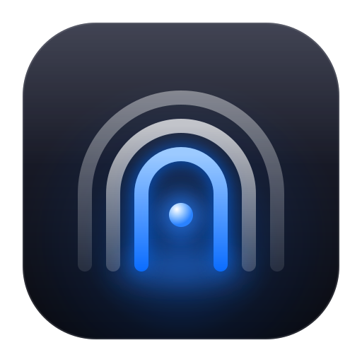
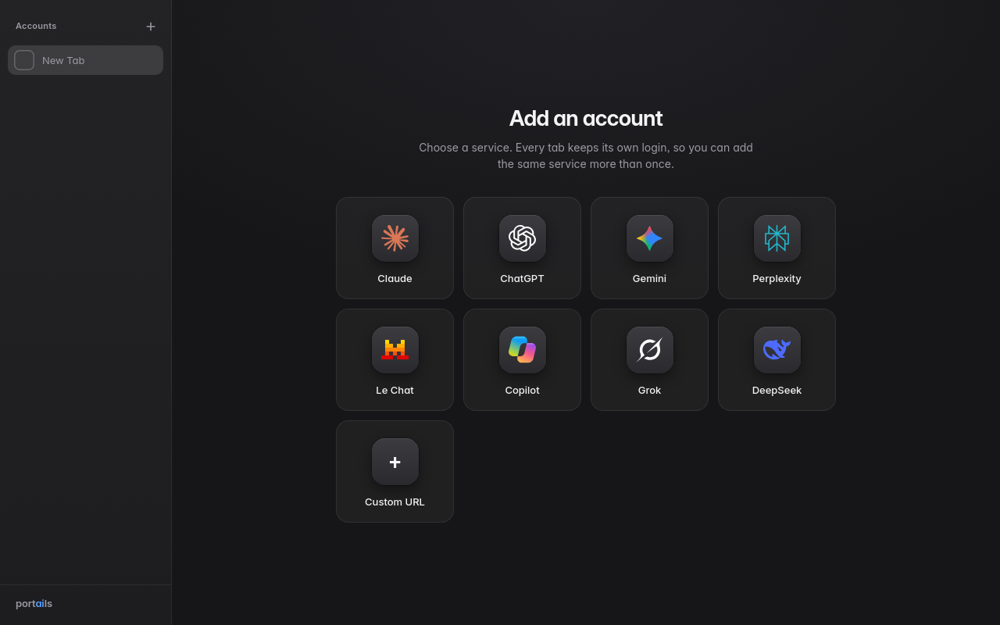
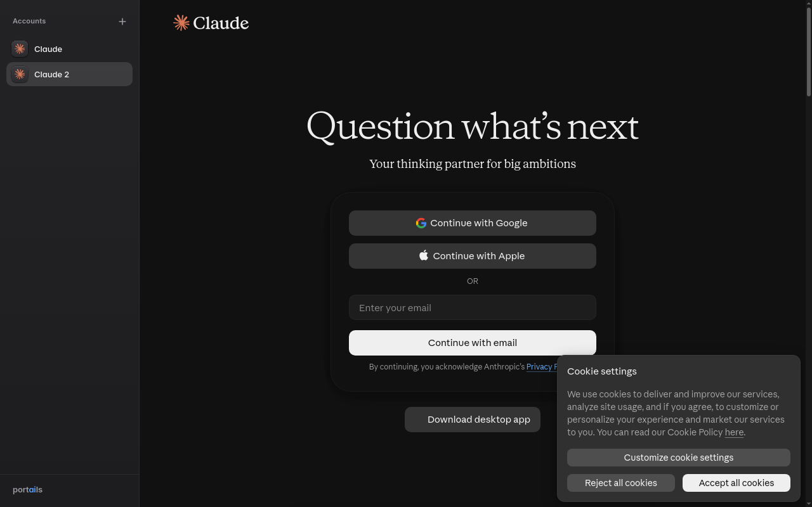
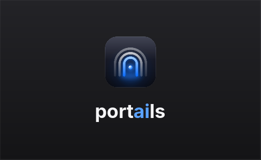
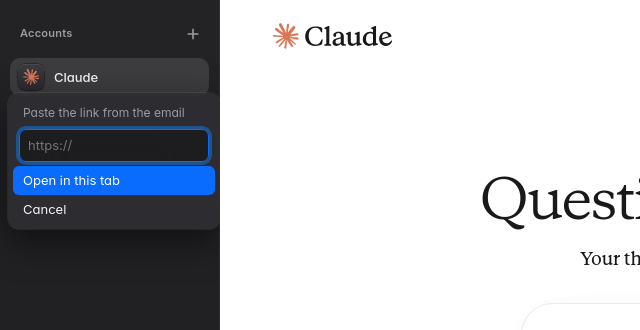

<p align="center"></p>

# portails

The app is called `portails`. In the sidebar wordmark the "ai" is blue. The name reads three ways: "portails" (French for portals), "port ai ls" and "port of AI lists".

A small desktop app that shows AI web portals as tabs in a sidebar. Each tab has its own login. You can sign in to two Claude accounts, a ChatGPT account and a Gemini account at the same time.





## How it works

- The sidebar on the left lists your tabs. The "+" button adds a tab. The "..." button on a tab opens a menu: Rename, Reload, Open link, Remove.
- A new tab opens a setup screen. Choose a service, name the tab, then select "Open and sign in".
- You sign in on the real website. The app never sees your password.
- Each tab has its own Chromium profile. Two tabs on the same website do not share a login.
- Remove deletes the tab and its saved login on this computer. It does not sign you out on the service. To end that session, sign out on the website.
- Tabs stay loaded in the background when you switch. A running chat continues.

Services in the catalog: Claude, ChatGPT, Gemini, Perplexity, Le Chat, Copilot, Grok, DeepSeek. "Custom URL" accepts any `https://` address.

The app uses Qt WebEngine, which is the Chromium engine, from the system Qt packages. It does not bundle a browser.

## Startup

A splash screen shows the logo and the wordmark while the app starts. The window appears when the sidebar page has loaded, or after 10 seconds at the latest.



## Logo

The logo is two doorways in front of a glowing one, like looking through several portals. The source is `assets/icon.svg`. Run `sh assets/render-icons.sh` to render the PNG sizes (16 to 512) that the app and the package use. It needs `rsvg-convert` (librsvg).

## Sign in with an email link

Some services send a sign-in link by email and no code. A click on that link opens your normal browser, and the sign-in happens there, not in the tab. To finish the sign-in in the tab:

1. In the email, copy the link address.
2. In portails, open the "..." menu of the tab and select "Open link...".
3. Paste the link and select "Open in this tab".



The link must start with `https://` and must belong to the site of the tab or to a known sign-in provider (Google, Apple, Microsoft, OpenAI, X). Other links are refused. The app does not save the link.

## Dark mode

The app always asks websites for their dark theme. Websites see `prefers-color-scheme: dark`, also when your system is set to light. A site that has a dark theme uses it. A page without a dark theme is not repainted and stays as it is.

Qt can only hold a color scheme with a platform theme that supports it. The default theme on X11 does not. So the app starts with the `gtk3` platform theme (`libqgtk3`, from `qt6-base`, needs `gtk3`). If you set `QT_QPA_PLATFORMTHEME` yourself, the app keeps your value. If that theme cannot hold a color scheme, the app prints a warning and sites may stay light.

## Saved logins are encrypted

A login is a cookie plus other site storage. portails never writes these as plain files in your home folder.

- While the app runs, the profile of each tab is in a RAM-backed folder (`$XDG_RUNTIME_DIR/portails`, owner only).
- Every 20 seconds, and when the app quits, the profile is packed and encrypted with AES-256-GCM. The encrypted file `profiles/<tab id>.vault` is the only copy on disk (mode 600, in a folder with mode 700).
- The key needs two things: `/etc/machine-id` and a random 32-byte secret in the desktop keyring (Secret Service: gnome-keyring, KWallet or KeePassXC). The app creates the secret the first time it runs. Both are mixed through HMAC-SHA256. Neither one alone is a key, and the machine id itself is never used as a key.
- Each file is tied to its tab id. A file copied to another tab name does not open.
- If a file does not decrypt (other computer, changed or damaged file, or a keyring secret that was deleted or replaced), the app deletes it and the tab starts logged out. You sign in again.
- If the keyring cannot be reached (for example it is locked or not running), the app saves nothing for that run and does not touch the saved files. They open again when the keyring works.
- Files from before the keyring layer open once with the old key, and are then saved with the new key. You stay signed in.
- SIGTERM, SIGINT and SIGHUP end the app through the normal quit path, so the profiles are written.

What this protects against: a profile copied to another computer through a backup, cloud sync or a dotfile repository is useless there. Someone who has only the files (a backup, a stolen disk) cannot open them without your keyring, and that is locked when you are logged out.

What it does not protect against:

- A program that runs as you while your keyring is unlocked. The source code is public, `/etc/machine-id` is readable, and the Secret Service gives its secrets to every program of your session. Such a program can work out the key. It can also read the profile in RAM while the app runs.
- A crash. Changes of the last 20 seconds can be lost, and then you sign in again.
- A session at the service. The service keeps the session valid until you sign out on its website.

If `/etc/machine-id`, `$XDG_RUNTIME_DIR` or a working keyring is missing, the app does not save logins at all. It prints the reason.

## Requirements

- Linux
- Qt 6 with WebEngine and WebChannel, and GTK 3 for the platform theme (on Arch: `pacman -S qt6-base qt6-webengine qt6-webchannel gtk3`)
- A Secret Service in your session, such as gnome-keyring, and `libsecret`
- OpenSSL, CMake, Ninja, pkg-config and a C++17 compiler to build

## Build and run

```
cmake -S . -B build -G Ninja -DCMAKE_BUILD_TYPE=Release
cmake --build build
./build/portails
```

## Test

```
QT_QPA_PLATFORM=offscreen ctest --test-dir build --output-on-failure
```

The tests cover the tab list, the catalog and its logos, address checks, link rules, the user agent, the encryption and the vault. The encryption tests check that a wrong key, a wrong tab, a changed byte and a path outside the folder are all rejected.

## Install

```
sh packaging/install.sh
```

The script needs the build above. It copies three files for the current user:

- `~/.local/bin/portails` (the binary)
- `~/.local/share/applications/portails.desktop` (the launcher entry)
- `~/.local/share/icons/hicolor/512x512/apps/portails.png` (the icon)

To remove the app, delete these three files. To remove saved tabs and logins, also delete `~/.local/share/portails/`.

## Arch package

```
cd packaging/arch
makepkg -f
sudo pacman -U portails-0.1.0-1-x86_64.pkg.tar.zst
```

The `PKGBUILD` builds from this working tree and runs the tests. It does not download source. The package depends on `qt6-base`, `qt6-webengine`, `qt6-webchannel`, `gtk3`, `libsecret` and `openssl`. It is about 0.4 MB, because Qt is shared with other programs.

There is no AppImage of this version. An AppImage would need to contain all of Qt WebEngine.

## Data

The app saves its data in `~/.local/share/portails/`.

- `tabs.json` lists the tabs.
- `profiles/<tab id>.vault` holds the encrypted login of one tab.

## Add a service

1. Add an entry to `platformCatalog()` in `src/platforms.cpp` (id, name, start URL). Change the array size in `src/platforms.h`.
2. Add the logo as `ui/logos/<id>.svg`.

A test checks that every service has a logo file.

## Browser features

Qt WebEngine is Chromium, but its build leaves out a few things that Chrome and Chromium have. Pages and sign-in checks can see this. The app adds them:

- The PDF viewer. Pages then see the same PDF plugin entries (`navigator.plugins`) as in Chrome.
- The `window.chrome` members `app`, `csi` and `loadTimes`, with the values a page expects. The source is `assets/chrome_object.js`.

Some sites, such as the sign-in of Google, can still refuse an app that is not a normal browser.

## User agent and language

Qt WebEngine puts a `QtWebEngine/x` token in its user agent. The app removes that token. The rest is the real Chromium user agent of the engine. The app also sends an `Accept-Language` header built from the system locale, for example `en-US,en;q=0.9`. To change the user agent, set `PORTAILS_USER_AGENT` to a full user agent. The value `engine` keeps the engine user agent as it is.

## Known limits

- Tested on Linux only.
- The sign-ins of Claude (email and Google), ChatGPT and Gemini were tested. Perplexity, Le Chat, Copilot, Grok and DeepSeek are in the catalog but were not tested.
- Some sites refuse sign-in in embedded browsers. That depends on the site.
- A popup of the site or of a sign-in provider (Google, Apple, Microsoft, OpenAI, X) opens in a small window with the same profile. Links to other sites open in the system browser.
- The tests that start the whole app ran on a virtual display with `--disable-gpu`, not on a real screen with a GPU.

## License

portails is free software under the GNU Affero General Public License, version 3 or any later version (`AGPL-3.0-or-later`). The text is in `LICENSE`. Each source file carries an SPDX identifier.

Other parts keep their own licenses:

- Inter font: SIL Open Font License 1.1 (`ui/fonts/Inter-LICENSE.txt`).
- Logos in `ui/logos/` come from the MIT-licensed `@lobehub/icons-static-svg` package. They are copies of the vector marks of each service. The names and marks belong to their owners. This project has no connection with them.
- Qt, OpenSSL and libsecret are used as shared libraries from the system, under their own licenses.
